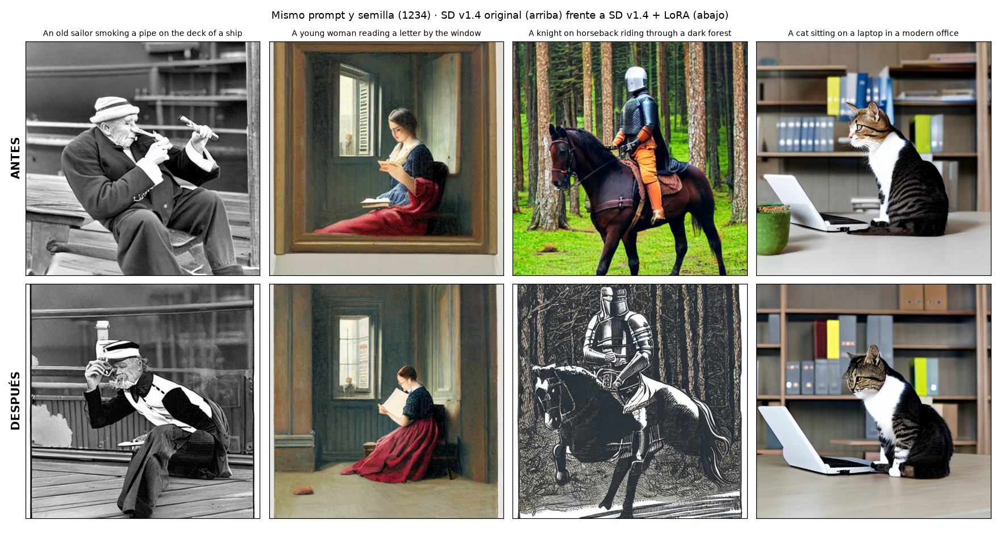

# 🖼️ LoRA de Stable Diffusion v1.4 · Ilustraciones de libros antiguos

Entrega final del módulo **Modelos de Generación de Imagen** del *Máster en IA, Cloud Computing y DevOps* (Pontia).

Finetuning con **LoRA** de [`CompVis/stable-diffusion-v1-4`](https://huggingface.co/CompVis/stable-diffusion-v1-4) sobre el dataset [`gigant/oldbookillustrations`](https://huggingface.co/datasets/gigant/oldbookillustrations) (grabados y litografías de libros de los siglos XVIII-XX). Como en la práctica de clase con el dataset de Pokémon, el objetivo es modificar el comportamiento del modelo para que genere imágenes con el estilo del nuevo dataset.

| Entregable | Archivo |
|---|---|
| 1. Notebook del finetuning (incluye subida al Hub e inferencia) | [`lora_sd_ilustraciones_antiguas.ipynb`](lora_sd_ilustraciones_antiguas.ipynb) |
| 2. Enlace al modelo en Hugging Face | [`enlace_huggingface.txt`](enlace_huggingface.txt) |
| 3. Mismo *prompt* antes y después del finetuning | [`resultados/ejemplo_antes_despues.png`](resultados/ejemplo_antes_despues.png) y [`resultados/antes_despues.png`](resultados/antes_despues.png) (4 *prompts*) |

Modelos en Hugging Face: [LoRA](https://huggingface.co/tmllabres/sd-v1-4-lora-ilustraciones-antiguas) · [modelo completo (LoRA fusionado)](https://huggingface.co/tmllabres/sd-v1-4-ilustraciones-antiguas)



## Qué hace el notebook

1. **Dataset**: se carga en *streaming* y leyendo **solo las columnas `1600px` (imagen) e `info_alt` (descripción)**, así no se descargan los ~5 GB del dataset completo, que incluye los escaneos originales. Se descartan las filas sin descripción.
2. **Imágenes no cuadradas**: todas tienen 1600 px de ancho y el alto varía (verticales y apaisadas). Se **redimensionan por el lado corto** a 512 px manteniendo la proporción, se aplica un **recorte central** de 512×512 y un volteo horizontal aleatorio, y se normalizan a [-1, 1]. El notebook muestra la distribución de proporciones y las imágenes tras el preprocesado.
3. **LoRA** (`peft`) sobre las proyecciones de atención de la UNet (`to_q`, `to_k`, `to_v`, `to_out.0`), con r = 8. Se entrena ~0,2 % de los parámetros de la UNet y el adaptador ocupa unos pocos MB.
4. **Entrenamiento** con `accelerate`: fp16 (pesos congelados en fp16 y LoRA en fp32), *gradient checkpointing*, AdamW con *learning rate* 1e-4, *warmup* y decaimiento coseno, y pérdida MSE sobre el ruido. Se muestra la curva de pérdida.
5. **Subida a Hugging Face** de dos repositorios, cada uno con su *model card*:
   - el **LoRA** (`pytorch_lora_weights.safetensors`);
   - el **modelo completo** finetuneado (LoRA fusionado en los pesos con `fuse_lora`).
6. **Inferencia desde el Hub** (como en clase): modelo base + `load_lora_weights("<usuario>/...")`, con los **mismos *prompts* y la misma semilla** que antes del entrenamiento, para que la única diferencia sea el LoRA.
7. **Extras**: intensidad del LoRA (`scale` 0 → 0,5 → 1) y un **experimento controlado con el rango r** (4 frente a 32, mismos datos y pasos), con tiempo, tamaño y resultado visual.

## Cómo ejecutarlo

### Opción A · Google Colab (recomendada, gratis)

1. Abre el notebook en Colab: *Archivo → Subir notebook*, o directamente desde GitHub:
   [colab.research.google.com/github/tmllabres/sd-lora-ilustraciones-antiguas/…](https://colab.research.google.com/github/tmllabres/sd-lora-ilustraciones-antiguas/blob/main/lora_sd_ilustraciones_antiguas.ipynb)
2. *Entorno de ejecución → Cambiar tipo de entorno de ejecución → **GPU T4***.
3. Crea un *token* de Hugging Face con permiso de **escritura** ([huggingface.co/settings/tokens](https://huggingface.co/settings/tokens)) y guárdalo en Colab como secreto **`HF_TOKEN`** (icono de la llave, a la izquierda, con «Acceso del notebook» activado). Si no, el notebook te lo pedirá.
4. *Entorno de ejecución → **Ejecutar todo***. Tarda unos 45-60 minutos en una T4.
5. Al final, la última celda descarga `entrega_resultados.zip` (carpeta `resultados/` + `enlace_huggingface.txt`). Descarga también el notebook ejecutado (*Archivo → Descargar → .ipynb*) y copia todo a este repositorio.

### Opción B · GPU local (NVIDIA, ≥ 12 GB de VRAM)

```bash
python -m venv .venv && .venv\Scripts\activate          # Linux/macOS: source .venv/bin/activate
pip install torch torchvision --index-url https://download.pytorch.org/whl/cu128   # cu128 o superior para las RTX 50
pip install -r requirements.txt
hf auth login                                           # token con permiso de escritura
jupyter lab lora_sd_ilustraciones_antiguas.ipynb
```

### Hiperparámetros para experimentar

Están todos en la clase `Config` (sección 1 del notebook):

| Parámetro | Por defecto | Efecto |
|---|---|---|
| `n_samples` | 1000 | Más imágenes: más variedad de estilo y más tiempo. |
| `train_batch_size` | 4 | Mayor *batch*: gradiente más estable y más VRAM. |
| `num_epochs` / `max_train_steps` | 3 / — | Pocas épocas: el estilo apenas cambia; muchas: sobreajuste a imágenes concretas. |
| `lora_rank` (r) / `lora_alpha` | 8 / 8 | Más rango: más capacidad y más parámetros. La escala efectiva es α/r. |
| `learning_rate` | 1e-4 | Valor típico de LoRA; con más, el estilo se aprende antes pero con más riesgo de degradar el modelo. |
| `center_crop` | `True` | `False` usa recorte aleatorio (aumento de datos, a veces corta a los personajes). |

## Estructura

```
├── lora_sd_ilustraciones_antiguas.ipynb   # finetuning + subida al Hub + inferencia
├── enlace_huggingface.txt                 # enlaces a los repos del Hub (lo genera el notebook)
├── resultados/                            # imágenes antes/después, escala del LoRA, curva de pérdida
├── requirements.txt
└── README.md
```

## Notas

- El filtro de seguridad (*safety checker*) de Stable Diffusion está activado. Si alguna imagen sale negra (falso positivo), basta con cambiar la semilla `SEED`.
- Licencia del modelo base: CreativeML OpenRAIL-M. Dataset: [gigant/oldbookillustrations](https://huggingface.co/datasets/gigant/oldbookillustrations) (ilustraciones de [oldbookillustrations.com](https://www.oldbookillustrations.com)).
